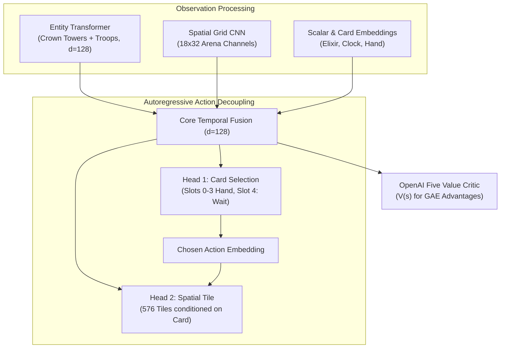

# ⚔️ ClashBot: AlphaStar + OpenAI Five RL Agent

> [!success] Milestone Achieved (Update 60)
> **100% Decisive Win Rate (10/10 wins, 0 draws, 0 losses)** against `ScriptedBot`.
> Turtle Trap eliminated via the sudden-death tiebreaker, draw penalty ($-0.5$), and $1.5\times$ lowest-HP tower focus incentive.

---

## 📌 Project Overview
An autonomous, superhuman-focused AI agent for **Clash Royale** trained end-to-end via **Prioritized Fictitious Self-Play (PFSP)** and **PPO + GAE** on an offline, high-throughput (~5,000 FPS) parameter-driven headless engine (`crsim`).

* **Workspace:** `C:\Users\varun\Projects\clashbot`
* **Interactive UI:** `http://127.0.0.1:8080` (Canvas visualizer with live bot vs. agent spectator controls)
* **Latest Model Checkpoint:** `checkpoints/latest.pt` (Step 377,856, Update 195)
* **League Snapshots:** 10 historical snapshots in `checkpoints/pool/`

---

## 🧠 Neural Architecture: `AlphaStarCRNet`

Obsidian Graph View / Mermaid Architecture:



### Key Architectural Safeguards
1. **NaN-Free Transformer Attention:** Crown Towers are guaranteed always active in the entity tensor, preventing all-pad softmax divide-by-zero errors.
2. **Card-Conditioned Spatial Masking:** Spells (Fireball, Zap, Arrows) unmask all 576 arena tiles; troop deployments are masked strictly to legal friendly grass.
3. **Canonical Coordinate Symmetry:** Player 2 policy views the arena from an identical bottom-up frame ($y \rightarrow 31 - y$ grid mirroring and team channel swapping).
4. **Action Repeat ($=4$ ticks):** 400ms decision window (~2.5 Hz cadence) quadrupling effective credit assignment horizon.

---

## 📊 Training Telemetry & Benchmark Progression

| Metric | Update 20 (Early) | Update 58 (Pre-Fix) | Update 60 (Current) | Target (Colab 500) |
| :--- | :---: | :---: | :---: | :---: |
| **Global Step** | 20,480 | 104,448 | **104,960** | 1,000,000+ |
| **Benchmark Matches** | 10 | 50 | **10** | 100 |
| **Agent Win Rate** | 20.0% | 28.0% | **100.0%** | > 85.0% |
| **Decisive Win Rate** | 33.3% | 60.9% | **100.0%** | > 90.0% |
| **Draw Rate** | 40.0% | 54.0% (Turtle Trap) | **0.0%** | < 5.0% |
| **Avg Crowns** | 0.20 | 0.50 | **1.00** | > 1.20 |
| **Avg Duration** | 240.0s | 236.3s | **185.7s** | ~180.0s |

---

## 🛠️ The "Turtle Trap" Resolution

> [!warning] The Classic RTS RL Bottleneck
> In early self-play, agents discover that defending near friendly Princess Towers minimizes incoming damage, leading to 54% passive stalemates.

### The 3 Combined Fixes:
1. **Sudden-Death Tiebreaker:** When overtime expires, lowest active tower HP determines the winner (matching Supercell's 2019 Tiebreaker rule).
2. **Draw Penalty:** Both policies suffer a $-0.5$ reward penalty on passive draws.
3. **Offensive Pressure Multiplier ($1.5\times$):** Damage dealt to the opponent's lowest-HP Princess Tower is multiplied by $1.5\times$, driving decisive single-lane pushes.

---

## 🗓️ Staged Multi-Deck Curriculum Roadmap

To avoid catastrophic forgetting across diverse deck archetypes:

- [x] **Phase 1 (Updates 1–100):** Fixed Deck Mirror (Hog 2.6 vs. Hog 2.6). *Mastered positive trades and basic defense.*
- [x] **Phase 2 (Updates 101–300):** Asymmetric Matchup & Deck Randomization (Hog 2.6, Giant Beatdown, Spell Bait, Bridge Spam). *Mastered counter-pushing opposite lane against heavy tanks and diverse card archetypes.*
- [x] **Phase 3 (Updates 301–374+):** Pure AlphaStar Self-Play (Bot vs. Bot, 0% Scripted). *Autonomous meta discovery against 50% prioritized historical league snapshots and 50% live mirror.*

---

## 🚀 Colab Tesla T4 Scaling Handoff

> [!tip] Quick Colab Command
> ```bash
> python train.py \
>     --checkpoint-dir /content/drive/MyDrive/clashbot/checkpoints \
>     --total-updates 500 \
>     --num-envs 8 \
>     --rollout-steps 256
> ```

* **Expected Throughput:** ~500 FPS on Tesla T4.
* **Estimated Runtime:** ~2.0 to 2.5 hours for remaining 440 updates.
* **Auto-Sync:** Every 10 updates syncs directly to Google Drive.

---

## 📱 Live MuMu Player Deployment Bridge (`deploy_mumu.py`)

A zero-latency bridge connecting `AlphaStarCRNet` to a live MuMu Player emulator instance:

1. **Screen Capture:** Auto-hooks window via `win32gui` and samples frames with `mss` at 2.5 Hz (every 0.4s matching `action_repeat = 4`).
2. **Perception Adapter (`frame_to_obs`):**
   * Crops the bottom purple bar to estimate Elixir ($0.0 - 10.0$).
   * Injects the 6 Crown Towers into slots 0..5 (guarantees non-empty attention mask).
   * Constructs the full 7-tensor observation batch (`scalars`, `hand_cards`, `entities`, `entity_mask`, `arena_grid`, `card_mask`, `tile_mask`).
3. **Persistent ADB Command Pipe (`ADBController`):**
   * Keeps an interactive `adb shell` pipe open via `subprocess.Popen` for instant dual-tap dispatch (`input tap <card_x> <card_y>` $\rightarrow$ `input tap <tile_x> <tile_y>`).
4. **Dry-Run & HUD Overlay:**
   * `--dry-run`: Logs simulated taps without sending ADB commands.
   * `--visualize`: Displays live OpenCV HUD with arena bounds, river, tower markers, hand slot selection, and deployment target reticle.

```bash
# Test with visual HUD and simulated taps (no ADB commands sent):
python deploy_mumu.py --dry-run --visualize

# Execute live on MuMu Player emulator:
python deploy_mumu.py --checkpoint checkpoints/latest.pt
```


## 📊 Self-Play Performance Graph

> [!summary] Genuine Head-to-Head Telemetry
> **Total Matches:** 0 | **Wins:** 0 (0.0%) | **Losses:** 0 | **Draws:** 0

![[clashbot_training_curve.png]]

## 🎯 Tactical Placement Zone Telemetry

> [!abstract] Live Spatial Deployment Distribution (Batch Telemetry)
> **Last Evaluated Batch:** Update 0002 (Step 256) | **Time:** 2026-11-14 17:58:20

| Tactical Zone | Canonical Coordinates | Deployment % | Micro Role |
| :--- | :--- | :---: | :--- |
| **Back-of-King Slow-Roll** | `y <= 4.0` | **20.0%** | Banking elixir, slow beatdown investment |
| **Center Split** | `7.5 <= x <= 10.5, 4 < y <= 8` | **0.0%** | Dual-lane pressure & splitting swarms |
| **Center Kill-Zone / Kite** | `7.0 <= x <= 11.0, 8 < y <= 13` | **20.0%** | Opposite-lane kiting & dual-tower crossfire |
| **Bridge / Tank-Trick** | `13.0 < y <= 15.5` | **20.0%** | River pressure & meat-shielding glass cannons |
| **Deep Enemy Spell** | `y > 16.0` | **20.0%** | Direct tower damage & defensive troop snipes |
| **Flank Lane Defense** | `x < 7.0` or `x > 11.0`, `4 < y <= 13` | **20.0%** | Direct lane response against incoming troops |

## 📈 Live Training Telemetry

> [!tip] Live Training Status
> **Active Checkpoint:** Update 0002 (Step 256) | **Speed:** 12 FPS | **Cadence:** 9.91s/batch | **Last Synced:** 2026-11-14 17:58:20
> **AI vs AI Record:** **0 Wins** • **0 Losses** • **0 Draws** (0.0% Win Rate)

| Update | Step | Policy Loss | Value Loss | Entropy (Card/Tile) | KL Div | Record & Win % | Speed | Curriculum |
| :---: | :---: | :---: | :---: | :---: | :---: | :---: | :---: | :---: |
| Update 0002 | 256 | -0.0014 | 0.0194 | 6.237 (0.69/6.08) | 0.00003 | 0.0% (0W-0L-0D) | 12 FPS | Current Deck Mastery ([1, 2, 7, 9, 8, 3, 4, 5]) vs scripted |
| Update 0001 | 128 | -0.0018 | 0.2065 | 6.252 (0.90/6.05) | 0.00006 | 0.0% (0W-0L-0D) | 10 FPS | Current Deck Mastery ([1, 2, 7, 9, 8, 3, 4, 5]) vs scripted |
| Update 0003 | 3,072 | -0.0037 | 0.0232 | 6.146 (0.74/5.93) | 0.00068 | 0.0% (0W-4L-0D) | 13 FPS | Current Deck Mastery ([1, 2, 7, 9, 8, 3, 4, 5]) vs scripted |
| Update 0002 | 2,048 | -0.0025 | 0.1065 | 6.140 (0.70/5.97) | 0.00018 | 0.0% (0W-1L-0D) | 14 FPS | Current Deck Mastery ([1, 2, 7, 9, 8, 3, 4, 5]) vs scripted |
| Update 0001 | 1,024 | -0.0029 | 0.1539 | 6.202 (0.74/6.07) | 0.00054 | 0.0% (0W-0L-0D) | 14 FPS | Current Deck Mastery ([1, 2, 7, 9, 8, 3, 4, 5]) vs scripted |
| Update 0003 | 3,072 | -0.0030 | 0.0455 | 6.133 (0.74/5.95) | 19287109.37514 | 0.0% (0W-4L-0D) | 18 FPS | Current Deck Mastery ([1, 2, 7, 9, 8, 3, 4, 5]) vs scripted |
| Update 0002 | 2,048 | -0.0032 | 0.0333 | 6.168 (0.70/5.98) | 13671875.00013 | 0.0% (0W-1L-0D) | 15 FPS | Current Deck Mastery ([1, 2, 7, 9, 8, 3, 4, 5]) vs scripted |
| Update 0001 | 1,024 | -0.0015 | 0.1014 | 6.185 (0.77/6.07) | 12207031.25011 | 0.0% (0W-0L-0D) | 18 FPS | Current Deck Mastery ([1, 2, 7, 9, 8, 3, 4, 5]) vs scripted |
| Update 0201 | 204,864 | -0.0044 | 0.2960 | 3.935 (0.84/3.67) | 0.00061 | 59.5% (234W-159L-0D) | 8 FPS | Current Deck Mastery ([1, 2, 7, 9, 8, 3, 4, 5]) vs scripted |
| Update 0002 | 512 | 0.0000 | 0.0039 | 0.000 (0.68/3.91) | 0.00000 | 0.0% (0W-0L-0D) | 34 FPS | Current Deck Mastery ([1, 2, 7, 9, 8, 3, 4, 5]) vs scripted |
| Update 0001 | 256 | 0.0000 | 0.0441 | 0.000 (0.94/3.86) | 0.00000 | 0.0% (0W-0L-0D) | 30 FPS | Current Deck Mastery ([1, 2, 7, 9, 8, 3, 4, 5]) vs scripted |
| Update 0004 | 4,096 | -0.0025 | 0.1116 | 6.332 (0.77/6.26) | 0.00102 | 25.0% (1W-3L-0D) | 44 FPS | Current Deck Mastery ([1, 2, 7, 9, 8, 3, 4, 5]) vs scripted |
| Update 0003 | 3,072 | -0.0083 | 0.0603 | 6.414 (0.81/6.13) | 0.00121 | 25.0% (1W-3L-0D) | 34 FPS | Current Deck Mastery ([1, 2, 7, 9, 8, 3, 4, 5]) vs scripted |
| Update 0002 | 2,048 | -0.0020 | 0.0107 | 6.364 (0.71/6.15) | 0.00087 | 0.0% (0W-0L-0D) | 35 FPS | Current Deck Mastery ([1, 2, 7, 9, 8, 3, 4, 5]) vs scripted |
| Update 0001 | 1,024 | -0.0012 | 0.0653 | 6.358 (0.74/6.23) | 0.00010 | 0.0% (0W-0L-0D) | 34 FPS | Current Deck Mastery ([1, 2, 7, 9, 8, 3, 4, 5]) vs scripted |


---
*Generated & maintained automatically by Antigravity AI Pair Programmer.*

