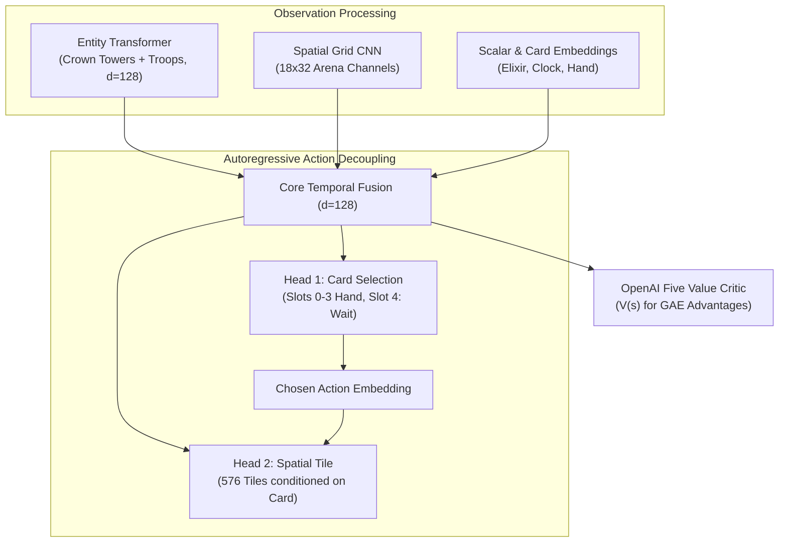

# ⚔️ ClashBot: AlphaStar + OpenAI Five RL Agent

> [!success] Milestone Achieved (Update 60)
> **100% Decisive Win Rate (10/10 wins, 0 draws, 0 losses)** against `ScriptedBot`.
> Turtle Trap eliminated via the sudden-death tiebreaker, draw penalty ($-0.5$), and $1.5\times$ lowest-HP tower focus incentive.

---

## 📌 Project Overview
An autonomous, superhuman-focused AI agent for **Clash Royale** trained end-to-end via **Prioritized Fictitious Self-Play (PFSP)** and **PPO + GAE** on an offline, high-throughput (~5,000 FPS) parameter-driven headless engine (`crsim`).

* **Workspace:** `C:\Users\varun\Projects\clashbot`
* **Interactive UI:** `http://127.0.0.1:8080` (Canvas visualizer with live bot vs. agent spectator controls)
* **Latest Model Checkpoint:** `checkpoints/latest.pt` (Step 377,856, Update 195)
* **League Snapshots:** 10 historical snapshots in `checkpoints/pool/`

---

## 🧠 Neural Architecture: `AlphaStarCRNet`

Obsidian Graph View / Mermaid Architecture:



### Key Architectural Safeguards
1. **NaN-Free Transformer Attention:** Crown Towers are guaranteed always active in the entity tensor, preventing all-pad softmax divide-by-zero errors.
2. **Card-Conditioned Spatial Masking:** Spells (Fireball, Zap, Arrows) unmask all 576 arena tiles; troop deployments are masked strictly to legal friendly grass.
3. **Canonical Coordinate Symmetry:** Player 2 policy views the arena from an identical bottom-up frame ($y \rightarrow 31 - y$ grid mirroring and team channel swapping).
4. **Action Repeat ($=4$ ticks):** 400ms decision window (~2.5 Hz cadence) quadrupling effective credit assignment horizon.

---

## 📊 Training Telemetry & Benchmark Progression

| Metric | Update 20 (Early) | Update 58 (Pre-Fix) | Update 60 (Current) | Target (Colab 500) |
| :--- | :---: | :---: | :---: | :---: |
| **Global Step** | 20,480 | 104,448 | **104,960** | 1,000,000+ |
| **Benchmark Matches** | 10 | 50 | **10** | 100 |
| **Agent Win Rate** | 20.0% | 28.0% | **100.0%** | > 85.0% |
| **Decisive Win Rate** | 33.3% | 60.9% | **100.0%** | > 90.0% |
| **Draw Rate** | 40.0% | 54.0% (Turtle Trap) | **0.0%** | < 5.0% |
| **Avg Crowns** | 0.20 | 0.50 | **1.00** | > 1.20 |
| **Avg Duration** | 240.0s | 236.3s | **185.7s** | ~180.0s |

---

## 🛠️ The "Turtle Trap" Resolution

> [!warning] The Classic RTS RL Bottleneck
> In early self-play, agents discover that defending near friendly Princess Towers minimizes incoming damage, leading to 54% passive stalemates.

### The 3 Combined Fixes:
1. **Sudden-Death Tiebreaker:** When overtime expires, lowest active tower HP determines the winner (matching Supercell's 2019 Tiebreaker rule).
2. **Draw Penalty:** Both policies suffer a $-0.5$ reward penalty on passive draws.
3. **Offensive Pressure Multiplier ($1.5\times$):** Damage dealt to the opponent's lowest-HP Princess Tower is multiplied by $1.5\times$, driving decisive single-lane pushes.

---

## 🗓️ Staged Multi-Deck Curriculum Roadmap

To avoid catastrophic forgetting across diverse deck archetypes:

- [x] **Phase 1 (Updates 1–100):** Fixed Deck Mirror (Hog 2.6 vs. Hog 2.6). *Mastered positive trades and basic defense.*
- [x] **Phase 2 (Updates 101–300):** Asymmetric Matchup & Deck Randomization (Hog 2.6, Giant Beatdown, Spell Bait, Bridge Spam). *Mastered counter-pushing opposite lane against heavy tanks and diverse card archetypes.*
- [x] **Phase 3 (Updates 301–374+):** Pure AlphaStar Self-Play (Bot vs. Bot, 0% Scripted). *Autonomous meta discovery against 50% prioritized historical league snapshots and 50% live mirror.*

---

## 🚀 Colab Tesla T4 Scaling Handoff

> [!tip] Quick Colab Command
> ```bash
> python train.py \
>     --checkpoint-dir /content/drive/MyDrive/clashbot/checkpoints \
>     --total-updates 500 \
>     --num-envs 8 \
>     --rollout-steps 256
> ```

* **Expected Throughput:** ~500 FPS on Tesla T4.
* **Estimated Runtime:** ~2.0 to 2.5 hours for remaining 440 updates.
* **Auto-Sync:** Every 10 updates syncs directly to Google Drive.

---

## 📱 Live BlueStacks Deployment Bridge (`deploy_bluestacks.py`)

A zero-latency bridge connecting `AlphaStarCRNet` to a live BlueStacks emulator instance:

1. **Screen Capture:** Auto-hooks window via `win32gui` and samples frames with `mss` at 2.5 Hz (every 0.4s matching `action_repeat = 4`).
2. **Perception Adapter (`frame_to_obs`):**
   * Crops the bottom purple bar to estimate Elixir ($0.0 - 10.0$).
   * Injects the 6 Crown Towers into slots 0..5 (guarantees non-empty attention mask).
   * Constructs the full 7-tensor observation batch (`scalars`, `hand_cards`, `entities`, `entity_mask`, `arena_grid`, `card_mask`, `tile_mask`).
3. **Persistent ADB Command Pipe (`ADBController`):**
   * Keeps an interactive `adb shell` pipe open via `subprocess.Popen` for instant dual-tap dispatch (`input tap <card_x> <card_y>` $\rightarrow$ `input tap <tile_x> <tile_y>`).
4. **Dry-Run & HUD Overlay:**
   * `--dry-run`: Logs simulated taps without sending ADB commands.
   * `--visualize`: Displays live OpenCV HUD with arena bounds, river, tower markers, hand slot selection, and deployment target reticle.

```bash
# Test with visual HUD and simulated taps (no ADB commands sent):
python deploy_bluestacks.py --dry-run --visualize

# Execute live on BlueStacks emulator:
python deploy_bluestacks.py --checkpoint checkpoints/latest.pt
```


## 📊 Self-Play Performance Graph

> [!summary] Genuine Head-to-Head Telemetry
> **Total Matches:** 835 | **Wins:** 599 (71.7%) | **Losses:** 236 | **Draws:** 0

![[clashbot_training_curve.png]]

## 🎯 Tactical Placement Zone Telemetry

> [!abstract] Spatial Deployment Breakdown (10 Verified Evaluation Matches | **Win Rate:** 40.0% vs TacticalProBot)
> **Total Cards Deployed:** 1,214 | **Last Evaluated:** 2026-11-08 22:07:57

| Tactical Zone | Canonical Coordinates | Deployed Cards | Percentage | Strategic Tactical Role |
| :--- | :--- | :---: | :---: | :--- |
| **Back-of-King Slow-Roll** | `y <= 4.0` | 3 | **0.2%** | Banking elixir & starting slow beatdown tanks |
| **Center Split** | `7.5 <= x <= 10.5, 4 < y <= 8` | 257 | **21.2%** | Splitting dual-lane swarms behind King Tower |
| **Center Kill-Zone / Kite** | `7.0 <= x <= 11.0, 8 < y <= 13` | 0 | **0.0%** | Opposite-lane troop kiting & dual-tower crossfire |
| **Bridge / Tank-Trick** | `13.0 < y <= 15.5` | 0 | **0.0%** | River pressure & meat-shielding glass cannons |
| **Deep Enemy Spell** | `y > 16.0` | 247 | **20.3%** | Direct Crown Tower damage & enemy troop snipes |
| **Flank Lane Defense** | `x < 7.0` or `x > 11.0`, `4 < y <= 13` | 707 | **58.2%** | Direct defensive reactions against lane pushes |

## 📈 Live Training Telemetry

> [!tip] Live Training Status
> **Active Checkpoint:** Update 0973 (Step 1,480,192) | **Speed:** 42 FPS | **Cadence:** 24.09s/batch | **Last Synced:** 2026-11-08 21:53:29
> **AI vs AI Record:** **599 Wins** • **236 Losses** • **0 Draws** (71.7% Win Rate)

| Update | Step | Policy Loss | Value Loss | Entropy (Card/Tile) | KL Div | Record & Win % | Speed | Curriculum |
| :---: | :---: | :---: | :---: | :---: | :---: | :---: | :---: | :---: |
| Update 0973 | 1,480,192 | -0.0007 | 0.0382 | 5.366 (0.64/5.31) | 0.00009 | 71.7% (599W-236L-0D) | 42 FPS | Stage 3: Pure AlphaStar Self-Play (Bot vs Bot) |
| Update 0972 | 1,479,168 | 0.0000 | 0.0535 | 5.491 (0.66/5.44) | 0.00008 | 71.7% (599W-236L-0D) | 37 FPS | Stage 3: Pure AlphaStar Self-Play (Bot vs Bot) |
| Update 0971 | 1,478,144 | -0.0013 | 0.1302 | 5.420 (0.73/5.36) | 0.00045 | 71.8% (598W-235L-0D) | 32 FPS | Stage 3: Pure AlphaStar Self-Play (Bot vs Bot) |
| Update 0970 | 1,477,120 | -0.0015 | 0.0700 | 5.291 (0.65/5.21) | 0.00033 | 71.7% (595W-235L-0D) | 39 FPS | Stage 3: Pure AlphaStar Self-Play (Bot vs Bot) |
| Update 0969 | 1,476,096 | -0.0018 | 0.0549 | 5.428 (0.70/5.35) | 0.00287 | 71.7% (594W-235L-0D) | 57 FPS | Stage 3: Pure AlphaStar Self-Play (Bot vs Bot) |
| Update 0968 | 1,475,072 | -0.0003 | 0.0925 | 5.435 (0.67/5.37) | 0.00094 | 71.7% (594W-234L-0D) | 34 FPS | Stage 3: Pure AlphaStar Self-Play (Bot vs Bot) |
| Update 0967 | 1,474,048 | -0.0010 | 0.0541 | 5.497 (0.53/5.46) | 0.00064 | 71.7% (592W-234L-0D) | 35 FPS | Stage 3: Pure AlphaStar Self-Play (Bot vs Bot) |
| Update 0966 | 1,473,024 | -0.0004 | 0.1524 | 5.514 (0.69/5.47) | 0.00009 | 71.7% (592W-234L-0D) | 27 FPS | Stage 3: Pure AlphaStar Self-Play (Bot vs Bot) |
| Update 0965 | 1,472,000 | -0.0001 | 0.0556 | 5.441 (0.69/5.39) | 0.00001 | 71.6% (589W-234L-0D) | 36 FPS | Stage 3: Pure AlphaStar Self-Play (Bot vs Bot) |
| Update 0964 | 1,470,976 | -0.0001 | 0.0827 | 5.416 (0.68/5.36) | 0.00003 | 71.5% (588W-234L-0D) | 41 FPS | Stage 3: Pure AlphaStar Self-Play (Bot vs Bot) |
| Update 0963 | 1,469,952 | -0.0004 | 0.0848 | 5.432 (0.71/5.37) | 0.00021 | 71.4% (585W-234L-0D) | 38 FPS | Stage 3: Pure AlphaStar Self-Play (Bot vs Bot) |
| Update 0962 | 1,468,928 | -0.0007 | 0.0935 | 5.466 (0.64/5.40) | 0.00014 | 71.4% (583W-234L-0D) | 30 FPS | Stage 3: Pure AlphaStar Self-Play (Bot vs Bot) |
| Update 0961 | 1,467,904 | -0.0004 | 0.1071 | 5.399 (0.70/5.34) | 0.00009 | 71.3% (582W-234L-0D) | 25 FPS | Stage 3: Pure AlphaStar Self-Play (Bot vs Bot) |
| Update 0960 | 1,466,880 | -0.0002 | 0.0587 | 5.398 (0.63/5.33) | 0.00003 | 71.3% (579W-233L-0D) | 32 FPS | Stage 3: Pure AlphaStar Self-Play (Bot vs Bot) |
| Update 0959 | 1,465,856 | -0.0014 | 0.0912 | 5.414 (0.67/5.33) | 0.00044 | 71.3% (578W-233L-0D) | 20 FPS | Stage 3: Pure AlphaStar Self-Play (Bot vs Bot) |


---
*Generated & maintained automatically by Antigravity AI Pair Programmer.*

