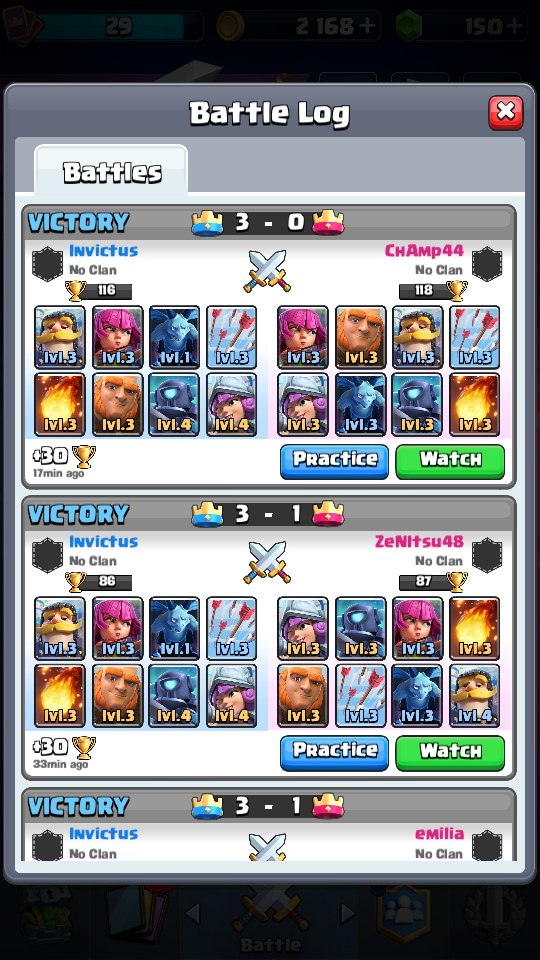

# CR-Zero: Autonomous Clash Royale AI Agent

[](https://www.python.org/downloads/)
[](https://pytorch.org/)
[](https://opensource.org/licenses/MIT)
[]()

**CR-Zero** is a dual-stage deep reinforcement learning and imitation learning AI agent engineered for real-time autonomous play in *Clash Royale*. 

The system operates across two environments:
1. **Windows 11 Live Actuation Engine:** Captures the BlueStacks 5 client window ($540 \times 960$ portrait) via DirectX Desktop Duplication / ADB memory streaming at 15–30 FPS (40.6ms actuation latency), parses screen states, extracts card hands and elixir, predicts deployment actions, and dispatches safety-gated taps.
2. **Dual-Stage Offline RL & Imitation Pipeline:** Trains a **Deck-Conditioned Policy Network** on GPU using **Behavior Cloning (BC)** with match-outcome weighting ($1.5\times$ for wins, $0.5\times$ for losses), followed by **Advantage-Weighted Regression (AWR)** fine-tuning ($w_t = \text{clip}(\exp(A_t / \beta), 0.05, 15.0)$) based on forward 10-second tower damage deltas and elixir trade differentials.

---

## Autonomous Match Record

CR-Zero has demonstrated autonomous battle loops on live ladder and training camp, securing **5 consecutive verified victories** (including 3–0 Three-Crown sweeps against real ladder opponents such as `DBZinferno_nami`, advancing trophies from 28 $\to$ 58).



---

## System Architecture

```
                                  [Offline Datasets]
              +-------------------------------------------------------+
              | - VanguardX101/IL_Replay (17.8M actions / 252k games) |
              | - Nitesh-04/Clash-Royale-Cards-Data (Official stats)  |
              | - chrisrca/clash-royale-tv-replays (540x960 frames)   |
              | - wty-yy/Clash-Royale-Detection-Dataset (26k sprites)  |
              +-------------------------------------------------------+
                                          |
                              [tools/ingest_*.py]
                                          |
                                          v
+------------------------+   +---------------------------------------+
| BlueStacks 5 (540x960) |   | Standardized Trajectory Shards (.npz) |
+------------------------+   |  - Spatial Arena Grid (32, 32, 18)    |
            |                |  - Scalar Features (12,)              |
   [DirectX / Fast ADB]      |  - Legal Action Masks (5,) & (576,)   |
            |                +---------------------------------------+
            v                                     |
+------------------------+                        v
| Perception Engine      |   +---------------------------------------+
|  - Screen State Gate   |   | Stage 1: Behavior Cloning (BC)        |
|  - Template Hand Match |   |  - Cross-Entropy + Outcome Weighting  |
|  - Elixir Color Tracker|   +---------------------------------------+
|  - Tower HP Detectors  |                        |
+------------------------+                        v
            |                +---------------------------------------+
            v                | Stage 2: Offline RL (AWR)             |
+------------------------+   |  - Advantage-Weighted Regression      |
| Strategic Policy       |   |  - Tower Damage & Elixir Advantage    |
|  - 135 Card Embeddings |   +---------------------------------------+
|  - Opponent Tracker    |                        |
|  - Spell Lead Aiming   |                        v
+------------------------+   <-- [checkpoints/cr_zero_policy_awr_best.pt]
            |
            v
+------------------------+
| Safety ADB Harness     |
|  - 800ms Cooldown      |
|  - Resolution Mapping  |
|  - F12 Emergency Panic |
+------------------------+
```

---

## 1. Integrated Public Datasets & Repositories

| Dataset / Repository | Platform / Creator | Volume & Format | Integration in CR-Zero |
| :--- | :--- | :--- | :--- |
| [`VanguardX101/IL_Replay`](https://huggingface.co/datasets/VanguardX101/IL_Replay) | Hugging Face | 17.8 Million card actions / 252k Ranked matches in Parquet | Ingested via `tools/ingest_vanguard_replays.py` into 30 new `.npz` shards matching CR-Zero's $(32, 18)$ spatial coordinates |
| [`Nitesh-04/Clash-Royale-Cards-Data`](https://huggingface.co/datasets/Nitesh-04/Clash-Royale-Cards-Data) | Hugging Face | Official Supercell card JSON (`clash_royale_cards_1.json`) | Ingested via `tools/update_card_features.py`, populating official attributes (air targeting, swarm, speed, range) |
| [`wty-yy/Clash-Royale-Detection-Dataset`](https://github.com/wty-yy/Clash-Royale-Detection-Dataset) | GitHub | 26,798 transparent in-arena sprites & segments | Cloned in `data/cr_detection_dataset` for card classification templates and in-arena unit segmentation |
| [`chrisrca/clash-royale-tv-replays`](https://huggingface.co/datasets/chrisrca/clash-royale-tv-replays) | Hugging Face | 52,900 frames at 10 FPS | Native $540 \times 960$ Android emulator recordings across all 31 arenas |
| [`clash-royale-bhjq1`](https://universe.roboflow.com/clash-royale-data-collection/clash-royale-bhjq1) | Roboflow Universe | 12,022 annotated gameplay images | 92.3% mAP@50 YOLO detection baseline |

---

## 2. Perception & Observation Specifications

### Spatial Arena Grid: `(32, 32, 18)` (`float32`)
The arena is mapped to 32 rows $\times$ 18 columns ($576$ tiles). Stacked across the 4 most recent frames ($4 \times 8 = 32$ channels):
- **Ch 0:** `ally_ground_count`
- **Ch 1:** `ally_air_count`
- **Ch 2:** `ally_towers` (King at `(31, 9)`, Princesses at `(26, 3)` and `(26, 14)`)
- **Ch 3:** `enemy_ground_count`
- **Ch 4:** `enemy_air_count`
- **Ch 5:** `enemy_towers` (King at `(0, 9)`, Princesses at `(5, 3)` and `(5, 14)`)
- **Ch 6:** `river_and_bridges` (River rows 15–16; bridges at columns 3–4 and 13–14)
- **Ch 7:** `spell_active_zone`

### Scalar Features: `(12,)` (`float32`, Normalized to $[0, 1]$)
- `[0]`: Ally Elixir ($0.0 \dots 1.0$)
- `[1]`: Estimated Enemy Elixir (from `OpponentTracker`)
- `[2]`: Ally King Tower HP ($0.0 \dots 1.0$)
- `[3]`: Ally Left Princess Tower HP ($0.0 \dots 1.0$)
- `[4]`: Ally Right Princess Tower HP ($0.0 \dots 1.0$)
- `[5]`: Enemy King Tower HP ($0.0 \dots 1.0$)
- `[6]`: Enemy Left Princess Tower HP ($0.0 \dots 1.0$)
- `[7]`: Enemy Right Princess Tower HP ($0.0 \dots 1.0$)
- `[8]`: Match Time Elapsed ($t / 180.0$)
- `[9]`: Double Elixir Indicator ($1.0$ if $t \ge 120\text{s}$, else $0.0$)
- `[10]`: Differential Tower HP
- `[11]`: Match Outcome Bias ($+1.0$ for win, $-1.0$ for loss)

### Legality Action Masks
- **Card Mask `(5,)`:** `[Wait=True, slot0_affordable, slot1_affordable, slot2_affordable, slot3_affordable]`.
- **Tile Mask `(576,)`:** Troops & buildings restricted to ally territory (rows 16..31) plus pocket territory if an enemy tower is destroyed. Spells and miner/goblin barrel can target any tile across the entire board.

---

## 3. Strategic Engine & Predictive Spell Physics

### Dynamic Spell Lead-Aiming
CR-Zero solves the projectile travel latency problem by calculating flight time from the King Tower:
$$t_{\text{flight}} = 1.0 + \frac{d}{8.0}$$
* **Stationary Units:** Targeted at their exact location with $0.0$ tile lead.
* **Marching Enemy Swarms:** Leading target by $+1.5$ to $+3.0$ tiles along the Y-axis into their path toward the bridge or princess tower.
* **Tower Finisher Protection:** 35-second opening lock prevents premature damage spells on full-HP towers.

### Opponent Elixir & Card Cycle Tracker
* Tracks enemy elixir expenditure and regeneration (1 elixir per 2.8s in normal time; 1 per 1.4s in double elixir).
* Tracks enemy 4-card cycle in memory to anticipate counter-pushes.

---

## 4. Live Execution & Safety Controls

### Safety Rails
* **Resolution Independence:** Automatically detects device rendering bounds and normalizes tap coordinates to client resolution ($540 \times 960$ or $720 \times 1280$).
* **Emergency Brake (F12):** Pressing **F12** at any moment triggers a graceful shutdown, aborting pending ADB taps and releasing file handles.
* **State Machine Guard:** Actuation is strictly gated to the `"battle"` state. Menus, loading screens, and victory prompts are handled by autonomous UI handlers.
* **Deployment Cooldown:** Enforces an 800ms minimum action cooldown between card drops to prevent server-side action dropping.

### Live Commands

#### Autonomous Ladder Match Runner (5 Consecutive Wins)
```powershell
python tools/play_5_wins.py --target-wins 5 --max-games 10
```

#### Live Match Play via Policy or Heuristics
```powershell
# 1. Run with Stage 2 AWR trained neural policy:
python main_live.py --weights weights/yolo_units.pt --checkpoint checkpoints/cr_zero_policy_awr_best.pt

# 2. Run with heuristic RuleBot (no neural weights required):
python main_live.py --rule-bot

# 3. Dry-run perception verification (safe test without real clicks):
python main_live.py --rule-bot --dry-run
```

---

## 5. Dual-Stage Training Pipeline

Interactive notebooks:
* Local workspace / IDE: [`train_cr_zero.ipynb`](train_cr_zero.ipynb)
* Google Colab: [`colab_pipeline/cr_zero_training.ipynb`](colab_pipeline/cr_zero_training.ipynb)

### CLI Training Commands

```powershell
# 1. Update official card features from Hugging Face
python tools/update_card_features.py

# 2. Ingest Vanguard ranked replays into trajectory shards
python tools/ingest_vanguard_replays.py --max-matches 30 --output-dir data/trajectories

# 3. Execute Stage 1 Behavior Cloning (BC)
python colab_pipeline/train_bc.py --data_dir data/trajectories --save_dir checkpoints --epochs 10 --batch_size 64

# 4. Execute Stage 2 Advantage-Weighted Regression (AWR)
python colab_pipeline/train_awr.py --shards-dir data/trajectories --init-checkpoint checkpoints/cr_zero_policy_best.pt --epochs 15 --batch-size 64 --beta 0.5
```

---

## 6. Verification & Test Suite

Run the full pytest suite:
```powershell
pytest tests/ -v
```

```
tests/test_all_requirements.py::TestCRZeroRequirements::test_01_global_card_vocabulary_and_unlocked PASSED
tests/test_all_requirements.py::TestCRZeroRequirements::test_02_regression_card_legality_and_affordability PASSED
tests/test_all_requirements.py::TestCRZeroRequirements::test_03_card_embedding_and_unseen_card PASSED
tests/test_all_requirements.py::TestCRZeroRequirements::test_04_canonicalization PASSED
tests/test_all_requirements.py::TestCRZeroRequirements::test_05_rule_bot_heuristics PASSED
tests/test_all_requirements.py::TestCRZeroRequirements::test_06_mocked_adb_safety_controls PASSED
tests/test_all_requirements.py::TestCRZeroRequirements::test_07_outcome_weighted_dataset PASSED
tests/test_awr_and_tracker.py::TestAWRAndTracker::test_awr_dataset_weighting PASSED
tests/test_awr_and_tracker.py::TestAWRAndTracker::test_awr_training_step PASSED
tests/test_awr_and_tracker.py::TestAWRAndTracker::test_opponent_tracker_elixir_and_cycle PASSED
============================= 10 passed in 8.13s =============================
```
