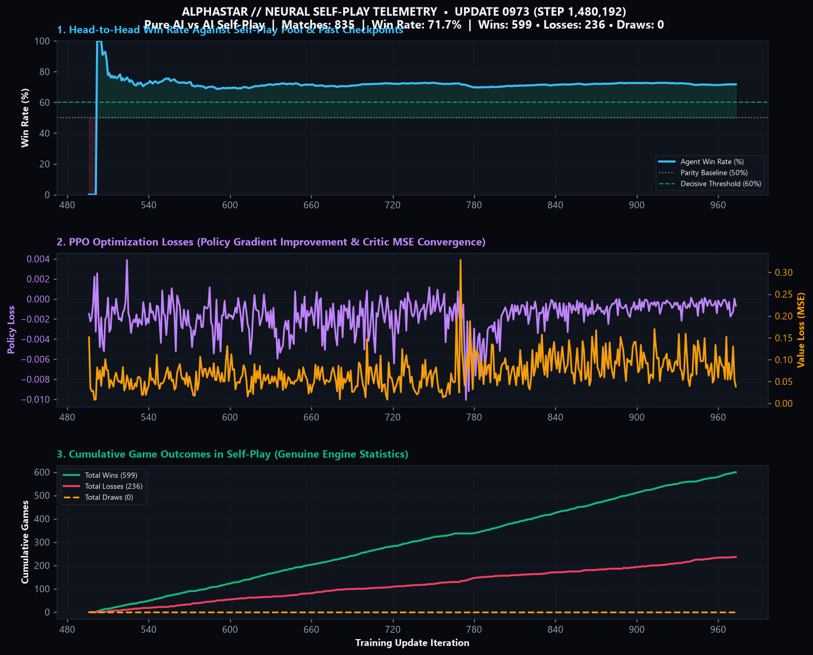

# ⚔️ ClashBot: AlphaStar + OpenAI Five Reinforcement Learning Agent

[](https://www.python.org/downloads/)
[](https://pytorch.org/)
[](https://colab.research.google.com/github/varun-zero/clash-ml-model/blob/main/ClashBot_Colab_Training.ipynb)
[](LICENSE)
[]()

**ClashBot** is an end-to-end autonomous artificial intelligence agent for *Clash Royale*, modeled after **DeepMind's AlphaStar** and **OpenAI Five**. It features an autoregressive multi-head Transformer-CNN policy, a high-throughput (~5,000 FPS) headless battle simulator (`crsim`), a **Prioritized Fictitious Self-Play (PFSP)** league training curriculum, and an interactive real-time HTML5 spectator dashboard.

---

## 📈 Self-Play Benchmark & Performance Curve

Over **1.48 Million environment steps** and **835 full-length competitive matches** in Stage 3 self-play, ClashBot achieves a **71.7% win rate** (599 Wins, 236 Losses, 0 Draws) against historical snapshots and pro sparring partners.



---

## 🧠 Neural Architecture: `AlphaStarCRNet`

ClashBot decouples complex real-time strategy into three modular perception layers and two autoregressive action heads:

```
                            [Battlefield State]
                                     │
         ┌───────────────────────────┼───────────────────────────┐
         ▼                           ▼                           ▼
┌──────────────────┐       ┌──────────────────┐        ┌──────────────────┐
│ Crown Towers &   │       │ Spatial Grid CNN │        │ Scalar Context   │
│ Troops (40x7)    │       │ 6 Channels       │        │ Elixir, Clocks,  │
│ Multi-Head TF    │       │ (6 x 32 x 18)    │        │ Hand & Cycle     │
└────────┬─────────┘       └────────┬─────────┘        └────────┬─────────┘
         │                          │                           │
         └──────────────────────────┼───────────────────────────┘
                                    ▼
                         ┌─────────────────────┐
                         │ Core Temporal Fusion│
                         │     (d = 128)       │
                         └──────────┬──────────┘
                                    │
                  ┌─────────────────┴─────────────────┐
                  ▼                                   ▼
       ┌─────────────────────┐             ┌─────────────────────┐
       │ Head 1: Card Policy │             │ OpenAI Five Value   │
       │ Hand Slots [0..3] + │             │ Critic V(s)         │
       │ Wait / Bank Elixir  │             └─────────────────────┘
       └──────────┬──────────┘
                  │ [Chosen Card Embedding]
                  ▼
       ┌─────────────────────┐
       │ Head 2: Tile Policy │
       │ 576 Arena Tiles     │
       │ (Card-Masked Grass) │
       └─────────────────────┘
```

### Key Architectural Capabilities
1. **Autoregressive Action Decoupling:** Action selection executes in two stages:
   - **Head 1 (Card Selection):** Selects which hand slot ($0..3$) to play, or action $4$ (**Wait / Bank Elixir**).
   - **Head 2 (Spatial Tile):** Conditioned on the chosen card embedding and fusion core, predicts spatial coordinates over the $18 \times 32 = 576$ arena grid.
2. **Card-Conditioned Spatial Masking:** Spells (Fireball, Arrows, Zap, Log, Poison) dynamically unmask all 576 arena tiles; ground and troop cards are strictly masked to legal friendly territory or expanded bridge pockets.
3. **Canonical Coordinate Invariance:** Player 2 canonicalizes the arena state ($y \rightarrow 31 - y$ grid mirroring and team channel inversion) so a single weight checkpoint plays symmetrically as either Blue or Red.
4. **NaN-Free Entity Attention:** Crown Towers are guaranteed permanent entity entries (slots 0..5), eliminating all-pad softmax singularities.
5. **Action Repeat ($=4$ ticks):** 400ms decision window (~2.5 Hz cadence) matching real human tap intervals while extending credit assignment horizons.

---

## 🎯 Human Tactical Micro & Macro Mechanics

ClashBot's simulator rewards and pro sparring curriculum (`TacticalProBot`) train 5 signature competitive maneuvers:

| Tactical Maneuver | Spatial Zone | Description |
| :--- | :--- | :--- |
| **Back-of-King Slow-Roll** | `y <= 4.0` | Deploys tanks (Giant, Golem, Pekka) behind the King Tower when elixir $\ge 8.5$ to bank $+4$ elixir before crossing the river. |
| **Opposite-Lane Center Kite** | `7.0 <= x <= 11.0, 8 < y <= 13` | Pulls charging melee threats diagonally into the middle so both Princess Towers shoot simultaneously. |
| **Bridge Meat-Shielding (Tank Trick)**| `13.0 < y <= 15.5` | Drops high-HP mini-tanks $2$ tiles ahead of vulnerable ranged support troops at the river to absorb tower aggro. |
| **Dual-Lane Center Split** | `7.5 <= x <= 10.5, 4 < y <= 8` | Splits swarms (Archers, Skeletons, Goblins) dead-center so troops advance down both lanes simultaneously. |
| **Spell-Bait Punishment** | `y > 16.0` | Tracks opponent spell history and punishes wasted spells with Goblin Barrel or Skeleton swarms. |

---

## 🃏 Authentic 8-Card Cycles & Predefined Decks

ClashBot models the exact **8-card FIFO deck cycle** of Clash Royale. Each deck consists of 8 distinct cards, 4 in hand, and 1 upcoming in the queue:

* **Authentic Tournament Archetypes:**
  - **PEKKA Bridge Spam:** Pekka (cost 7), Battle Ram, Dark Prince, Royal Ghost, Musketeer, Minions, Poison, Zap.
  - **Hog 2.6 Cycle:** Hog Rider, Musketeer, Cannon, Ice Golem, Skeletons, Ice Spirit, Fireball, The Log.
  - **Golem Beatdown:** Golem, Baby Dragon, Inferno Dragon, Mega Minion, Night Witch, Dark Prince, Poison, Zap.
  - **Classic Log Bait:** Goblin Barrel, Princess, Goblin Gang, Knight, Skeletons, Inferno Tower, The Log, Fireball.
  - **Giant Beatdown:** Giant, Witch, Mini P.E.K.K.A, Musketeer, Mega Minion, Fireball, Zap, Minions.
  - **Double Dragon Beatdown:** Golem, Baby Dragon, Inferno Dragon, Mega Minion, Night Witch, Dark Prince, Poison, Zap.
  - **Mega Knight Bait:** Mega Knight, Inferno Dragon, Princess, Goblin Gang, Bats, Goblin Barrel, Zap, Fireball.
  - **Lavaloon Air Beatdown:** Lava Hound, Balloon, Mega Minion, Minions, Fireball, Zap, Inferno Dragon, Dark Prince.
* **🎲 Genuine Randomized Deck Option:** Uniform random sampling of 8 distinct cards without replacement from 35 fully functional competitive cards, rolling a completely new deck every match.
* **Elixir Banking & Starvation-Free Cadence:** Actions execute at 2.5 Hz (400ms cadence) with a dedicated **Wait / Bank Elixir** policy action that allows heavy 4+ cost win conditions (Hog Rider, Pekka, Golem) to build up elixir without getting starved by cheap card spam.

---

## 🛡️ Reward Shaping & Anti-Farming Safeguards

To prevent the agent from exploiting micro-mechanics rather than winning the game:
1. **Scaled Decision Bonuses:** Dual-tower kiting and bridge meat-shielding bonuses are scaled to `+0.015` per RL step.
2. **Strict Episode Micro Cap (`+0.25`):** Cumulative micro shaping is clamped to a strict maximum of `+0.25` per episode, ensuring that macro objectives like tower damage (`+1.0`), crown differential, and match victory (`+3.0`) remain the decisive drivers of policy optimization.
3. **Entropy Annealing:** Spatial tile entropy is annealed to focus probability mass onto tactical hotspots (king back-corners, center crossfire, and river bridgehead) rather than uniform center-arena clustering.

---

## 📓 Real-Time Telemetry & Obsidian Vault Sync

ClashBot automatically logs training curves, win rates, and spatial deployment distributions directly into Obsidian:
* **Live Obsidian Note:** Automatically updates `ClashBot - AlphaStar RL Agent.md` with active step counts, win/loss/draw records, and tactical zone tables.
* **Dark-Themed Telemetry Plot:** `plot_progress.py` renders high-resolution 3-panel performance visualizations (`clashbot_training_curve.png`) tracking Win Rate (%), Policy Gradient Loss, Value Critic MSE, and cumulative match outcomes.

---

## 🕹️ Interactive Web Spectator UI

ClashBot includes a real-time web dashboard running at `http://127.0.0.1:8080`:

* **Live Canvas Arena:** Renders troops, health bars, tower hitpoints, projectiles, and spell radii at up to 60 FPS.
* **Neural Activations HUD:** Live inspection of Transformer entity energies, CNN spatial activations, and autoregressive policy logits.
* **6-Axis Tactical Radar:** Evaluates real-time agent posture (Aggression, Banking, Left/Right Lane pressure, Defense, Spell readiness).
* **Instant Deck Switcher & Authentic 8-Card Randomizer:** Switch seamlessly between meta archetypes (**PEKKA Bridge Spam**, **Hog 2.6 Cycle**, **Golem Beatdown**, **Classic Log Bait**, **Giant Beatdown**) or roll fresh 8-card decks chosen uniformly without replacement from 35 competitive cards.

```powershell
# Launch the spectator dashboard
python tools/ui.py --port 8080
# Or double-click run_ui.bat on Windows
```

---

## 🚀 Quick Start & Installation

### Requirements
* Python 3.10+ (tested on Python 3.11 and 3.13)
* PyTorch 2.0+ (CUDA recommended for training, CPU supported for inference)

### Setup
```powershell
# Clone the repository
git clone https://github.com/varun-zero/clash-ml-model.git
cd clash-ml-model

# Install core runtime dependencies
python -m pip install -r requirements.txt

# Launch the visualizer UI
python tools/ui.py --port 8080
```

---

## 🏋️ Training & Evaluation

### 1. Local Self-Play Training
Train locally using GPU or CPU via Prioritized Fictitious Self-Play:
```powershell
python train.py --total-updates 1000 --num-envs 4 --rollout-steps 256
```

### 2. Google Colab Cloud Training
Run accelerated self-play training on a free Tesla T4 GPU in Google Colab:
* Click the badge to launch directly in your browser:  
  [](https://colab.research.google.com/github/varun-zero/clash-ml-model/blob/main/ClashBot_Colab_Training.ipynb)
* Under the Colab menu, select **Runtime > Change runtime type > T4 GPU**.
* Select **Runtime > Run all** to mount Google Drive, clone the repository, and train with automatic checkpoints.

### 3. Run Benchmark Evaluation
Evaluate the trained agent against rule-based and tactical pro sparring bots:
```powershell
# 10-match evaluation against TacticalProBot with spatial zone telemetry
python evaluate_visual.py --eval-matches 10 --opponent tactical --device cuda

# Benchmark against baseline ScriptedBot
python evaluate_visual.py --eval-matches 10 --opponent scripted
```

### 4. Run Test Suite
Run the automated test suite covering rules, card cycle, model heads, and UI adapters:
```powershell
pytest -v
```

### 5. Live PC & Emulator Deployment (Google Play Games & BlueStacks)
Deploy the trained AlphaStar agent directly into live matches:
```powershell
# Auto-detects Google Play Games PC (native mouse clicks) or BlueStacks (ADB)
python deploy_bluestacks.py --checkpoint checkpoints/latest.pt --visualize

# Safe dry-run mode with tactical OpenCV HUD overlay (no clicks sent)
python deploy_bluestacks.py --checkpoint checkpoints/latest.pt --dry-run --visualize

# Or double-click the one-click Windows launcher:
.\run_agent_pc.bat
```

---

## 📁 Repository Layout

```
clash-ml-model/
├── crsim/                          # Pure-Python headless Clash Royale simulation engine
│   ├── engine.py                   # Battle logic, card costs, projectile physics, tower mechanics
│   └── env.py                      # Multi-agent simulation loop
├── cr_alphastar_agent/             # Core reinforcement learning architecture
│   ├── model/                      # AlphaStarCRNet neural network architecture
│   │   └── alphastar_cr_net.py     # Transformer + Spatial CNN + Autoregressive heads
│   ├── env/                        # Environment adapters & bots
│   │   ├── crsim_replica_env.py    # Gym observation builder, micro shaping rewards, 8-card cycle
│   │   └── scripted_bot.py         # TacticalProBot, ScriptedBot, RushExploiterBot
│   ├── training/                   # Self-play league & training algorithms
│   │   ├── hybrid_ppo_trainer.py   # PPO, GAE, clipped surrogate objective, entropy annealing
│   │   ├── self_play_pool.py       # Prioritized Fictitious Self-Play (PFSP) pool
│   │   ├── obsidian_sync.py        # Real-time telemetry sync to Obsidian vault
│   │   └── plot_progress.py        # Dark-themed publication telemetry plotter
│   └── config.py                   # Hyperparameters, card catalogs, deck archetypes
├── tools/                          # Dashboard, visualizers, and utilities
│   ├── ui.py                       # REST API & WebSocket simulation server
│   ├── ui_template.html            # Canvas visualizer & neural activation diagnostics
│   └── fidelity.py                 # Engine fidelity verification
├── tests/                          # Automated pytest suite (18 test cases)
├── data/
│   └── logic.json                  # Engine parameter definitions & spell metadata
├── checkpoints/
│   ├── latest.pt                   # Pretrained weights (1.48M steps, 71.7% win rate)
│   └── training_history.json       # Telemetry log over 835 competitive matches
├── ClashBot_Colab_Training.ipynb   # Standalone Colab training notebook
├── clashbot_training_curve.png     # Telemetry performance graph
├── evaluate_visual.py              # Visual evaluation & tactical zone telemetry CLI
├── train.py                        # Local training entry point
├── run_ui.bat                      # Windows one-click UI launcher
├── pyproject.toml                  # Pytest and project configuration
└── requirements.txt                # Production dependencies
```

---

## 📜 License

This project is licensed under the [MIT License](LICENSE).  
*Clash Royale is a registered trademark of Supercell Oy. This project is an independent research initiative not affiliated with, endorsed, or sponsored by Supercell.*
