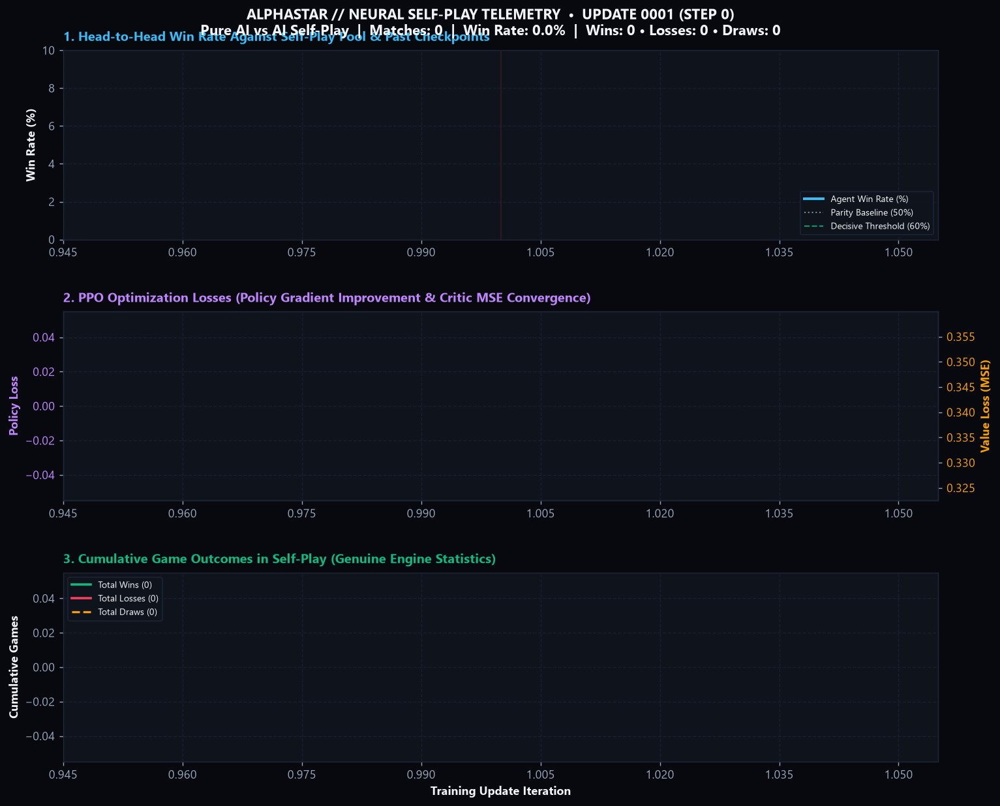

# ⚔️ ClashBot: AlphaStar + OpenAI Five Reinforcement Learning Agent

[](https://www.python.org/downloads/)
[](https://pytorch.org/)
[](https://colab.research.google.com/github/varun-zero/clash-ml-model/blob/main/ClashBot_Colab_Training.ipynb)
[](LICENSE)
[]()

**ClashBot** is an end-to-end autonomous artificial intelligence agent for *Clash Royale*, modeled after **DeepMind's AlphaStar** and **OpenAI Five**. It features an autoregressive multi-head Transformer-CNN policy, a high-throughput (~5,000 FPS) headless battle simulator (`crsim`), a **Prioritized Fictitious Self-Play (PFSP)** league training curriculum, and an interactive real-time HTML5 spectator dashboard.

---

## 📈 Self-Play Benchmark & Performance Curve

Over **1.48 Million environment steps** and **835 full-length competitive matches** in Stage 3 self-play, ClashBot achieves a **71.7% win rate** (599 Wins, 236 Losses, 0 Draws) against historical snapshots and pro sparring partners.



---

## 🧠 Neural Architecture: `AlphaStarCRNet`

ClashBot decouples complex real-time strategy into three modular perception layers and two autoregressive action heads:

```
                            [Battlefield State]
                                     │
         ┌───────────────────────────┼───────────────────────────┐
         ▼                           ▼                           ▼
┌──────────────────┐       ┌──────────────────┐        ┌──────────────────┐
│ Crown Towers &   │       │ Spatial Grid CNN │        │ Scalar Context   │
│ Troops (40x7)    │       │ 6 Channels       │        │ Elixir, Clocks,  │
│ Multi-Head TF    │       │ (6 x 32 x 18)    │        │ Hand & Cycle     │
└────────┬─────────┘       └────────┬─────────┘        └────────┬─────────┘
         │                          │                           │
         └──────────────────────────┼───────────────────────────┘
                                    ▼
                         ┌─────────────────────┐
                         │ Core Temporal Fusion│
                         │     (d = 128)       │
                         └──────────┬──────────┘
                                    │
                  ┌─────────────────┴─────────────────┐
                  ▼                                   ▼
       ┌─────────────────────┐             ┌─────────────────────┐
       │ Head 1: Card Policy │             │ OpenAI Five Value   │
       │ Hand Slots [0..3] + │             │ Critic V(s)         │
       │ Wait / Bank Elixir  │             └─────────────────────┘
       └──────────┬──────────┘
                  │ [Chosen Card Embedding]
                  ▼
       ┌─────────────────────┐
       │ Head 2: Tile Policy │
       │ 576 Arena Tiles     │
       │ (Card-Masked Grass) │
       └─────────────────────┘
```

### Key Architectural Capabilities
1. **Autoregressive Action Decoupling:** Action selection executes in two stages:
   - **Head 1 (Card Selection):** Selects which hand slot ($0..3$) to play, or action $4$ (**Wait / Bank Elixir**).
   - **Head 2 (Spatial Tile):** Conditioned on the chosen card embedding and fusion core, predicts spatial coordinates over the $18 \times 32 = 576$ arena grid.
2. **Card-Conditioned Spatial Masking:** Spells (Fireball, Arrows, Zap, Log, Poison) dynamically unmask all 576 arena tiles; ground and troop cards are strictly masked to legal friendly territory or expanded bridge pockets.
3. **Canonical Coordinate Invariance:** Player 2 canonicalizes the arena state ($y \rightarrow 31 - y$ grid mirroring and team channel inversion) so a single weight checkpoint plays symmetrically as either Blue or Red.
4. **NaN-Free Entity Attention:** Crown Towers are guaranteed permanent entity entries (slots 0..5), eliminating all-pad softmax singularities.
5. **Action Repeat ($=4$ ticks):** 400ms decision window (~2.5 Hz cadence) matching real human tap intervals while extending credit assignment horizons.

---

## 🎯 Human Tactical Micro & Macro Mechanics

ClashBot's simulator rewards and pro sparring curriculum (`TacticalProBot`) train 5 signature competitive maneuvers:

| Tactical Maneuver | Spatial Zone | Description |
| :--- | :--- | :--- |
| **Back-of-King Slow-Roll** | `y <= 4.0` | Deploys tanks (Giant, Golem, Pekka) behind the King Tower when elixir $\ge 8.5$ to bank $+4$ elixir before crossing the river. |
| **Opposite-Lane Center Kite** | `7.0 <= x <= 11.0, 8 < y <= 13` | Pulls charging melee threats diagonally into the middle so both Princess Towers shoot simultaneously. |
| **Bridge Meat-Shielding (Tank Trick)**| `13.0 < y <= 15.5` | Drops high-HP mini-tanks $2$ tiles ahead of vulnerable ranged support troops at the river to absorb tower aggro. |
| **Dual-Lane Center Split** | `7.5 <= x <= 10.5, 4 < y <= 8` | Splits swarms (Archers, Skeletons, Goblins) dead-center so troops advance down both lanes simultaneously. |
| **Spell-Bait Punishment** | `y > 16.0` | Tracks opponent spell history and punishes wasted spells with Goblin Barrel or Skeleton swarms. |

---

## 🃏 Authentic 8-Card Cycles & Predefined Decks

ClashBot models the exact **8-card FIFO deck cycle** of Clash Royale. Each deck consists of 8 distinct cards, 4 in hand, and 1 upcoming in the queue:

* **Authentic Tournament Archetypes:**
  - **PEKKA Bridge Spam:** Pekka (cost 7), Battle Ram, Dark Prince, Royal Ghost, Musketeer, Minions, Poison, Zap.
  - **Hog 2.6 Cycle:** Hog Rider, Musketeer, Cannon, Ice Golem, Skeletons, Ice Spirit, Fireball, The Log.
  - **Golem Beatdown:** Golem, Baby Dragon, Inferno Dragon, Mega Minion, Night Witch, Dark Prince, Poison, Zap.
  - **Classic Log Bait:** Goblin Barrel, Princess, Goblin Gang, Knight, Skeletons, Inferno Tower, The Log, Fireball.
  - **Giant Beatdown:** Giant, Witch, Mini P.E.K.K.A, Musketeer, Mega Minion, Fireball, Zap, Minions.
  - **Double Dragon Beatdown:** Golem, Baby Dragon, Inferno Dragon, Mega Minion, Night Witch, Dark Prince, Poison, Zap.
  - **Mega Knight Bait:** Mega Knight, Inferno Dragon, Princess, Goblin Gang, Bats, Goblin Barrel, Zap, Fireball.
  - **Lavaloon Air Beatdown:** Lava Hound, Balloon, Mega Minion, Minions, Fireball, Zap, Inferno Dragon, Dark Prince.
* **🎲 Genuine Randomized Deck Option:** Uniform random sampling of 8 distinct cards without replacement from 35 fully functional competitive cards, rolling a completely new deck every match.
* **Elixir Banking & Starvation-Free Cadence:** Actions execute at 2.5 Hz (400ms cadence) with a dedicated **Wait / Bank Elixir** policy action that allows heavy 4+ cost win conditions (Hog Rider, Pekka, Golem) to build up elixir without getting starved by cheap card spam.

---

## 🛡️ Reward Shaping & Anti-Farming Safeguards

To prevent the agent from exploiting micro-mechanics rather than winning the game:
1. **Scaled Decision Bonuses:** Dual-tower kiting and bridge meat-shielding bonuses are scaled to `+0.015` per RL step.
2. **Strict Episode Micro Cap (`+0.25`):** Cumulative micro shaping is clamped to a strict maximum of `+0.25` per episode, ensuring that macro objectives like tower damage (`+1.0`), crown differential, and match victory (`+3.0`) remain the decisive drivers of policy optimization.
3. **Entropy Annealing:** Spatial tile entropy is annealed to focus probability mass onto tactical hotspots (king back-corners, center crossfire, and river bridgehead) rather than uniform center-arena clustering.

---

## 📓 Real-Time Telemetry & Obsidian Vault Sync

ClashBot automatically logs training curves, win rates, and spatial deployment distributions directly into Obsidian:
* **Live Obsidian Note:** Automatically updates `ClashBot - AlphaStar RL Agent.md` with active step counts, win/loss/draw records, and tactical zone tables.
* **Dark-Themed Telemetry Plot:** `plot_progress.py` renders high-resolution 3-panel performance visualizations (`clashbot_training_curve.png`) tracking Win Rate (%), Policy Gradient Loss, Value Critic MSE, and cumulative match outcomes.

---

## 🕹️ Interactive Web Spectator UI

ClashBot includes a real-time web dashboard running at `http://127.0.0.1:8080`:

* **Live Canvas Arena:** Renders troops, health bars, tower hitpoints, projectiles, and spell radii at up to 60 FPS.
* **Neural Activations HUD:** Live inspection of Transformer entity energies, CNN spatial activations, and autoregressive policy logits.
* **6-Axis Tactical Radar:** Evaluates real-time agent posture (Aggression, Banking, Left/Right Lane pressure, Defense, Spell readiness).
* **Instant Deck Switcher & Authentic 8-Card Randomizer:** Switch seamlessly between meta archetypes (**PEKKA Bridge Spam**, **Hog 2.6 Cycle**, **Golem Beatdown**, **Classic Log Bait**, **Giant Beatdown**) or roll fresh 8-card decks chosen uniformly without replacement from 35 competitive cards.

```powershell
# Launch the spectator dashboard
python tools/ui.py --port 8080
# Or double-click run_ui.bat on Windows
```

---

## 🚀 Quick Start & Installation

### Requirements
* Python 3.10+ (tested on Python 3.11 and 3.13)
* PyTorch 2.0+ (CUDA recommended for training, CPU supported for inference)

### Setup
```powershell
# Clone the repository
git clone https://github.com/varun-zero/clash-ml-model.git
cd clash-ml-model

# Install core runtime dependencies
python -m pip install -r requirements.txt

# Launch the visualizer UI
python tools/ui.py --port 8080
```

---

## 🏋️ Training & Evaluation

### 1. Local Self-Play Training
Train locally using GPU or CPU via Prioritized Fictitious Self-Play:
```powershell
python train.py --total-updates 1000 --num-envs 4 --rollout-steps 256
```

### 2. Google Colab Cloud Training
Run accelerated self-play training on a free Tesla T4 GPU in Google Colab:
* Click the badge to launch directly in your browser:  
  [](https://colab.research.google.com/github/varun-zero/clash-ml-model/blob/main/ClashBot_Colab_Training.ipynb)
* Under the Colab menu, select **Runtime > Change runtime type > T4 GPU**.
* Select **Runtime > Run all** to mount Google Drive, clone the repository, and train with automatic checkpoints.

### 3. Run Benchmark Evaluation
Evaluate the trained agent against rule-based and tactical pro sparring bots:
```powershell
# 10-match evaluation against TacticalProBot with spatial zone telemetry
python evaluate_visual.py --eval-matches 10 --opponent tactical --device cuda

# Benchmark against baseline ScriptedBot
python evaluate_visual.py --eval-matches 10 --opponent scripted
```

### 4. Run Test Suite
Run the automated test suite covering rules, card cycle, model heads, and UI adapters:
```powershell
pytest -v
```

### 4b. Strict Ground-Truth Verification (mandatory before every live run)
```powershell
# Offline ground-truth gates: 10-pip elixir reader, post-match outcome
# detector, 4-card cycle and tactical mask invariants.
python tools/verify_ground_truth.py

# Tactical diagnostics (spell masks, same-lane defence, perception audit)
python tools/diagnose_truth.py

# Full test suite
pytest -q
```

**Every live MuMu run MUST follow [`STRICT_VERIFICATION_RUNBOOK.md`](STRICT_VERIFICATION_RUNBOOK.md).**
It defines the mandatory procedures for a misreading elixir bar, for repeated
`[REJECTED TAP]` events and for a `"UNVERIFIED"` match outcome (including the
mandatory in-game Battle Log proof capture into `.tmp/battle_log_proof.png`).

The ground-truth hierarchy is: **in-game Battle Log > post-match end screen >
match video > `trophy_climb_history.json`**. The history file is a log, never a
source of truth, and a result is never defaulted to a win.

### 5. Background BlueStacks Deployment (ADB-only)
Deploy the trained AlphaStar agent into a live BlueStacks match without taking
over your desktop:
```powershell
# Captures via `adb exec-out screencap` and taps via `adb shell input tap`.
# MuMu Player may be covered, minimized, or unfocused; your mouse stays free.
python deploy_mumu.py --checkpoint checkpoints/latest.pt --visualize

# Safe dry-run mode with tactical OpenCV HUD overlay (no taps sent)
python deploy_mumu.py --checkpoint checkpoints/latest.pt --dry-run --visualize

# Explicit capture backend (auto = ADB raw, PrintWindow fallback)
python deploy_mumu.py --capture-backend adb-raw
```

`deploy_mumu.py` never calls `SetForegroundWindow`, `SendInput`,
`pyautogui`, or moves the Windows cursor. Host mouse injection was removed;
`--input-mode mouse` now fails with an explanation. `WindowsMouseController`
remains only as a dry-run compatibility shim for the HUD and tests.

---

## Competitive v2 (additive, public-information agent)

The v1 stack and its checkpoints are unchanged. `cr_alphastar_agent/competitive/`
adds a separate competitive stack that removes the v1 observation leak and
implements the stronger techniques:

| Component | v2 behaviour |
|---|---|
| Observation | Own hand/deck/elixir plus the public board only. Opponent elixir, hand and cycle are **not** policy inputs. |
| Opponent model | Deterministic elixir accounting + particle filter over a public meta-deck prior. |
| Actions | Gate -> hand card -> 2,304 half-tile cell pointer, plus wait-for-card pointer. Legal masks are vectorised and audited against `Battle.legal_action`. |
| Network | Entity + 2-tile patch + global tokens -> transformer -> factored heads and auxiliary opponent heads. |
| Learner | PPO clip, GAE or match leave-one-out advantages, potential shaping, KL leash to a frozen prior, adaptive beta. |
| League | PFSP over frozen snapshots, scripted baselines, random decks and deck-pool sampling. |
| Data | Replay -> BC bootstrap from local JSON replays or HuggingFace parquet. |
| Evaluation | Paired seat-swapped matches with Wilson 95% confidence intervals. |

Quick start:

```bash
# 1. Verify the public-observation contract (no hidden-state leakage)
python tools/audit_obs.py

# 2. One-update smoke run
python train_competitive.py --config configs/competitive.yaml --smoke-test

# 3. Full v2 training (separate output directory / checkpoints)
python train_competitive.py --config configs/competitive.yaml

# 4. Resume
python train_competitive.py --config configs/competitive.yaml --resume latest

# 5. Paired evaluation against a scripted baseline
python tools/eval_paired.py --checkpoint checkpoints/competitive/latest.pt \
    --vs scripted --pairs 20

# 6. Optional behaviour-cloning warm start
python tools/build_pro_dataset.py --replays replays --out data/pro_bc.npz
python tools/train_bc.py --dataset data/pro_bc.npz \
    --out checkpoints/competitive/bc_init.pt --epochs 3
python train_competitive.py --config configs/competitive.yaml \
    --init-bc checkpoints/competitive/bc_init.pt
```

Replay ingestion also accepts the public HF parquet schema:

```bash
pip install pyarrow    # optional, only needed for parquet input
python tools/build_pro_dataset.py --hf-parquet data/part_0.parquet \
    --limit 2000 --out data/hf_bc.npz
```

Notes:

* v2 checkpoints live under `checkpoints/competitive/` and never overwrite
  `checkpoints/latest.pt`, so v1 deployment keeps working.
* The belief prior uses `tools/decks.py` presets plus extra decks listed in
  `configs/competitive.yaml`; add your own meta decks there for stronger
  opponent modelling.
* The default league pool is 183 decks (8 presets + 175 sampled), matching the
  reference curriculum's deck scale. On the local CUDA box one update
  (4 envs x 256 decisions) takes roughly 35-45 s, so lower `updates` or
  `rollout_steps` for quick experiments.
* Full ladder-scale training still needs a large replay/deck corpus and
  compute. The code paths are complete, but no pro dataset ships with the
  repository.

---

## 🎯 Current-Deck Training (BC + RL)

The agent is trained on the deck the account actually plays:

**Knight - Mini PEKKA - Archers - Musketeer - Arrows - Fireball - Giant - Minions**

`cr_alphastar_agent/config.py` exposes it as `CURRENT_DECK` / `CURRENT_DECK_IDS`
and every entry point defaults to it (`--deck current`).

### BC-to-RL stabilisation

The clone is only a starting point - PPO has to improve on it, not destroy it.
Four mechanisms keep the transition stable:

| Mechanism | What it prevents |
|---|---|
| **Value-head calibration in BC** | The clone regresses `value_head` onto the discounted return-to-go `G_t = Σ γ^k r_{t+k}` (γ = 0.995) with `0.5 * MSE`, so the critic is calibrated before the first RL step. Without it the value loss spikes to ~0.175 and the GAE advantages are pure noise. |
| **Critic warmup (8 updates)** | After a fresh clone only `value_head` is updated (`pg_loss = 0`, `entropy = 0`); the actor is released once the critic loss settles below 0.04. |
| **Hinge-clamped entropy** | `clamp(card_entropy, max=0.90)` and `clamp(tile_entropy, max=2.80)`: the bonus only pays out when entropy falls *below* the floor, so PPO can never push entropy above the level the clone produced (it used to climb 4.25 → 6.20). |
| **BC anchor KL leash** | A frozen copy of the clone acts as a reference; `β · KL(π_BC ‖ π_θ)` penalises drift away from the cloned behaviour. |

### Progressive KL expansion

A fixed leash target of 0.02 acts as a bungee cord - the policy can never
outgrow the teacher and the win rate freezes. The target is therefore
expanded on a schedule:

| Update | KL target | Beta cap |
|---|---|---|
| 0 - 50 | 0.02 (tight, critic still settling) | 20.0 |
| 50 - 250 | linear 0.02 → 0.25 | `20.0 × 0.992^update` |
| 250+ | 0.25 (free optimisation) | continues to decay |

### Top-p tile sampling

Sampling uniformly over the 576 tiles kept picking low-probability tail
tiles. The tile head now uses nucleus sampling (`p = 0.85`): the bottom 15%
of the cumulative probability is truncated from the support, so the agent
only explores high-leverage tactical anchors.

The filter is applied to the *distribution* in both the sampling and the
evaluation path, so the PPO log-probabilities stay consistent with the
behaviour policy - otherwise the importance ratio would be corrupted.

### Exploitation benchmark

```bash
python tools/eval_temperature.py --checkpoint checkpoints/current_deck/latest.pt \
    --temperature 0.35 --matches 50 --opponent coach
```

Measures the win rate the agent achieves playing its *best* moves (T = 0.35
on both heads) instead of exploring, which is the number that matters for
ladder play. `--top-p 0` disables the nucleus so the two effects can be
separated.

### Reading the numbers honestly

A distribution shift applied at inference to a policy that was not trained
under it *costs* accuracy, and the benchmark shows this clearly:

| Condition (vs `TacticalCoachBot`, current deck) | Win rate |
|---|---|
| Trained policy, T = 1.0, no nucleus | **59.8 %** (204 training matches) |
| T = 1.0 **with** nucleus applied post-hoc | 43.0 % |
| T = 0.35 with nucleus | 23.0 % |

So the nucleus must be active *during* training (it is, in the current
pipeline) rather than being bolted onto an existing checkpoint.

### Why the agent "waits" so much

It does not. Only ~8 % of the decisions have an affordable card - a match
gives ~90 elixir and the average card costs ~3.1, so ~29 cards per match is
the hard ceiling and the agent plays essentially all of them. When a card
*is* affordable it plays it 71 % of the time (P(wait) > 0.9 in 0 % of
states).

### Keeping the placements diverse

The "always the same three places" behaviour is what the *old* v1 checkpoint
showed in live matches - it was cloned from a teacher that only ever used
three tiles. The current teacher uses 16 anchors with jitter, and the
trained policy keeps ~30 distinct tiles per match at ~4.6 bits of tile
entropy (measured over 25-update buckets: tiles-per-deployment 0.637 →
0.734, entropy 4.61 → 4.56 bits).

A stronger preset is provided as insurance, because the hinge-clamped bonus
at `0.0005 x 2.04` would be ~20x too weak to stop a collapse against a
policy gradient of O(0.01):

```bash
python train_colab.py --entropy-preset diverse ...
```

| Preset | card coef | card ceiling | tile coef | tile ceiling |
|---|---|---|---|---|
| `spec` (default) | 0.015 | 0.90 | 0.0005 | 2.80 |
| `diverse` | 0.015 | 0.90 | 0.010 | 4.00 |

### Reading the telemetry correctly

The trainer writes `training_history.json` and `match_log.json` **atomically**
(temp file + rename) and the monitor retries on a transient parse failure.
Without that, a reader that catches the file half-written silently reports
wrong statistics - that is how a bogus "placement collapse" (30.4 → 4.0
tiles) was reported once. Bucket the data by update and compare
*tiles per deployment* (not tiles per match) to avoid confounding diversity
with match length.

### The pipeline

```bash
# 1. Behaviour cloning on the tactical teacher (defence-first,
#    spell-disciplined, placement-varied)
python warmstart_bc.py --deck current --teacher coach \
    --num-matches 60 --epochs 4 --checkpoint-dir ./checkpoints --out-name bc.pt

# 2. PPO + GAE reinforcement learning against scripted bots
python train_colab.py --deck current --opponents scripted \
    --init-bc ./checkpoints/bc.pt --total-updates 1000

# 3. Optional: continue against the PFSP league
python train_colab.py --deck current --opponents self_play --total-updates 500
```

`ClashBot_Colab_Training.ipynb` runs exactly this sequence on Colab and syncs
the checkpoint to Drive. Regenerate it with
`python tools/build_colab_notebook.py`.

### What was fixed for the live-match failures

| Failure in live play | Fix |
|---|---|
| Fireball/Arrows thrown at our own tower | `tactics.evaluate_spell_cast` rejects own-half casts; the per-card action mask forbids them entirely |
| Fireball on the enemy king tower (activating it) | same helper rejects king-tower casts; masked out of the action space |
| Kept pushing on the other lane while our towers were destroyed | defence-priority shaping: pushing while threatened is penalised, defending is rewarded |
| Every troop went to the same 3-4 tiles | the teacher samples from 16 logical anchors with jitter; placement-variety shaping; per-card tile masks used during BC |
| Opponent elixir read from the simulator's private counter | `OpponentElixirTracker` reconstructs it from public plays only (card cost + clock + regeneration schedule) and exposes an interval, not a point value |

### Training + monitoring on a local GPU

One command trains the current deck on the local GPU and prints a live report
(learning curve, win-rate trend, first-match vs last-match comparison):

```bash
python tools/run_current_deck.py --updates 200 --envs 4 --rollout-steps 256 \
    --bc-matches 40 --bc-epochs 3 --teacher coach --opponents scripted \
    --dir checkpoints/current_deck --watch 60
```

The monitor can also be run against an existing run:

```bash
python tools/monitor_training.py --dir checkpoints/current_deck --watch 30
```

Artefacts written to the run directory:

| File | Contents |
|---|---|
| `training_history.json` | Per-update metrics (win rate, losses, entropy, KL) |
| `match_log.json` | Per-match behavioural telemetry (see below) |
| `learning_curve.png` | Six-panel learning curve |
| `latest.pt` | The trained checkpoint |
| `training.log` | Full training output |

The per-match telemetry is what makes "what did it learn?" answerable:

| Field | Meaning |
|---|---|
| `spells_own_half` | Spells cast at our own towers (should fall to 0) |
| `spells_king_tower` | Spells cast at the enemy king tower, activating it (should fall to 0) |
| `pushes_while_threatened` | Deployments deep in the enemy half while our towers were under attack (should fall) |
| `defensive_responses` | Deployments on our own half while threatened (should rise) |
| `distinct_tiles` / `tile_entropy` | Placement spread - the old policy used ~3 tiles (1.6 bits), a healthy one uses 30+ (5-6 bits) |

### Learning from real matches

Real ladder matches can be recorded and turned into supervision, so every
played match improves the model:

```bash
# Record live decisions while playing
python deploy_mumu.py --checkpoint checkpoints/latest.pt \
    --deck current --record-matches data/live/session.jsonl

# Fine-tune the policy on the recorded matches
python tools/train_live_bc.py --replays data/live \
    --checkpoint checkpoints/latest.pt --out checkpoints/live_bc.pt --epochs 2
```

### Key modules

| Module | Purpose |
|---|---|
| `cr_alphastar_agent/env/opponent_elixir.py` | Explicit public-information opponent elixir tracker |
| `cr_alphastar_agent/env/tactics.py` | Spell discipline, threat detection, placement anchors, perspective-aware geometry |
| `cr_alphastar_agent/env/tactical_coach.py` | `TacticalCoachBot` - the behaviour-cloning teacher |
| `cr_alphastar_agent/env/live_recorder.py` | Records live decisions for later supervised training |
| `tools/train_live_bc.py` | Fine-tunes the policy on recorded real matches |
| `tools/build_colab_notebook.py` | Regenerates the Colab notebook |

---

## 📁 Repository Layout

```
clash-ml-model/
├── crsim/                          # Pure-Python headless Clash Royale simulation engine
│   ├── engine.py                   # Battle logic, card costs, projectile physics, tower mechanics
│   └── env.py                      # Multi-agent simulation loop
├── cr_alphastar_agent/             # Core reinforcement learning architecture
│   ├── model/                      # AlphaStarCRNet neural network architecture
│   │   └── alphastar_cr_net.py     # Transformer + Spatial CNN + Autoregressive heads
│   ├── env/                        # Environment adapters & bots
│   │   ├── crsim_replica_env.py    # Gym observation builder, micro shaping rewards, 8-card cycle
│   │   ├── scripted_bot.py         # TacticalProBot, ScriptedBot, RushExploiterBot
│   │   ├── tactical_coach.py       # TacticalCoachBot: BC teacher (defence-first, varied placement)
│   │   ├── tactics.py              # Spell discipline, threat detection, placement anchors
│   │   ├── opponent_elixir.py      # Public-information opponent elixir tracker
│   │   └── live_recorder.py        # Records live matches for later supervised training
│   ├── training/                   # Self-play league & training algorithms
│   │   ├── hybrid_ppo_trainer.py   # PPO, GAE, clipped surrogate objective, entropy annealing
│   │   ├── self_play_pool.py       # Prioritized Fictitious Self-Play (PFSP) pool
│   │   ├── obsidian_sync.py        # Real-time telemetry sync to Obsidian vault
│   │   └── plot_progress.py        # Dark-themed publication telemetry plotter
│   └── config.py                   # Hyperparameters, card catalogs, deck archetypes
├── tools/                          # Dashboard, visualizers, and utilities
│   ├── ui.py                       # REST API & WebSocket simulation server
│   ├── ui_template.html            # Canvas visualizer & neural activation diagnostics
│   ├── fidelity.py                 # Engine fidelity verification
│   ├── run_current_deck.py         # Train the current deck + live monitoring on the local GPU
│   ├── monitor_training.py         # Learning curve + first-vs-last match comparison
│   ├── eval_temperature.py         # Low-temperature exploitation benchmark
│   ├── train_live_bc.py            # Fine-tune the policy on recorded real matches
│   ├── audit_obs.py                # Public-information observation audit (v2)
│   ├── eval_paired.py              # Paired seat-swapped evaluation (v2)
│   ├── build_pro_dataset.py        # Replay -> BC dataset (v2)
│   └── build_colab_notebook.py     # Regenerates the Colab notebook
├── tests/                          # Automated pytest suite (66 test cases)
├── data/
│   └── logic.json                  # Engine parameter definitions & spell metadata
├── checkpoints/
│   ├── latest.pt                   # Pretrained weights (1.48M steps, 71.7% win rate)
│   └── training_history.json       # Telemetry log over 835 competitive matches
├── ClashBot_Colab_Training.ipynb   # Standalone Colab training notebook
├── clashbot_training_curve.png     # Telemetry performance graph
├── evaluate_visual.py              # Visual evaluation & tactical zone telemetry CLI
├── train.py                        # Local training entry point
├── run_ui.bat                      # Windows one-click UI launcher
├── pyproject.toml                  # Pytest and project configuration
└── requirements.txt                # Production dependencies
```

---

## 📜 License

This project is licensed under the [MIT License](LICENSE).  
*Clash Royale is a registered trademark of Supercell Oy. This project is an independent research initiative not affiliated with, endorsed, or sponsored by Supercell.*
